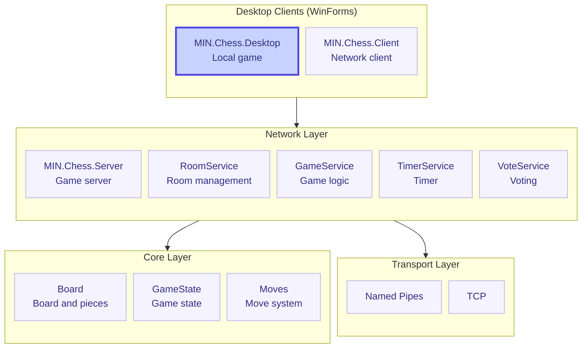
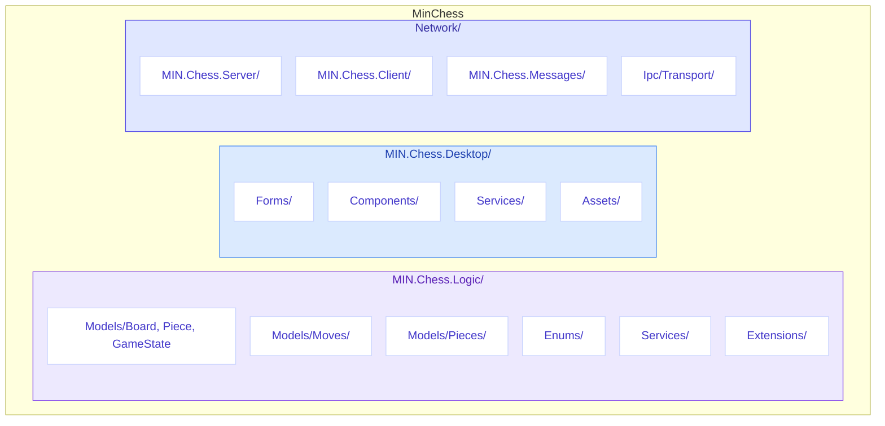

# MinChess


> **Multiplayer chess with full rules implementation, timer, and spectator support**

[](https://github.com/MIN-Corp/MIN.Chess/stargazers)
[](https://github.com/MIN-Corp/MIN.Chess/network/members)
[](https://github.com/MIN-Corp/MIN.Chess/blob/main/LICENSE)
[](https://dotnet.microsoft.com/)
[](https://docs.microsoft.com/en-us/dotnet/csharp/)

[English](README.md) • [Русский](README.ru.md)

---

## Table of Contents

- [Features](#-features)
- [Architecture](#-architecture)
- [Tech Stack](#-tech-stack)
- [Installation & Setup](#-installation--setup)
- [Project Structure](#-project-structure)
- [Gameplay](#-gameplay)
- [Rules](#-rules)
- [Authors](#-authors)

---

## Features

| Feature | Description |
|---------|-------------|
| **Full chess rules** | All piece moves, castling, en passant, pawn promotion |
| **Timer** | Configurable game time (1-30 min) with increment (0-20 sec) |
| **Premoves** | Queue moves in advance, executed when it's your turn |
| **Spectators** | Unlimited viewers for a single game |
| **Role switching** | A spectator can take an empty player slot |
| **Voting** | Joint decisions on draw or restart |
| **Resign** | Option to concede the game |
| **Network play** | Play over LAN (Named Pipes / TCP) |
| **Desktop UI** | Intuitive WinForms interface with drag-and-drop |
| **Captured pieces display** | Visual counter of captured opponent pieces |
| **Pause menu** | Ability to pause the game |

> [!IMPORTANT]
> MinChess runs on the **MIN** platform via Named Pipes or TCP. Players and spectators can connect to a game from the local network.

---

## Architecture



### Modules

#### Core
| Module | Purpose |
|--------|---------|
| `MIN.Chess.Logic` | Full chess logic implementation |

#### Desktop (UI)
| Module | Purpose |
|--------|---------|
| `MIN.Chess.Desktop` | Local desktop client |

#### Network
| Module | Purpose |
|--------|---------|
| `MIN.Chess.Server` | Game server, message handling |
| `MIN.Chess.Client` | Network client for connecting to a game |
| `MIN.Chess.Messages` | Messages and exchange protocol |
| `MIN.Ipc.Transport.NamedPipes` | Named Pipes transport |
| `MIN.Ipc.Transport.Tcp` | TCP transport |

---

## Tech Stack

| Category | Technology | Description |
|----------|------------|-------------|
| Language | C# | Modern object-oriented language |
| Platform | .NET 8.0 | Cross-platform framework |
| UI | WinForms | Desktop Windows interface |
| Transport | Named Pipes / TCP | Inter-process and network communication |
| Style | .editorconfig | Consistent code style |

---

## Installation & Setup

### Prerequisites

> [!TIP]
> Make sure you have .NET SDK 8.0 or higher installed.

- [.NET SDK 8.0](https://dotnet.microsoft.com/download/dotnet/8.0) or higher
- Windows 10/11
- MIN platform (included in the repository)

### Quick Start

```bash
# 1. Clone the repository
git clone https://github.com/MIN-Corp/MIN.Chess.git
cd MinChess

# 2. Restore dependencies
dotnet restore

# 3. Build the project
dotnet build

# 4. Start the server
dotnet run --project Network/MIN.Chess.Server/MIN.Chess.Server.csproj

# 5. Start the client (in a separate terminal)
dotnet run --project Network/MIN.Chess.Client/MIN.Chess.Client.csproj
```

---

## Project Structure



> [!NOTE]
> Project settings are centralized via `Directory.Build.props` and `Directory.Packages.props`.

---

## Gameplay

1. **Game start** — two players take White and Black slots
2. **Timer setup** — White player chooses game time and increment
3. **Playing** — players take turns, spectators watch
4. **Premoves** — queue moves in advance; they execute when it's your turn
5. **Game end** — checkmate, stalemate, resignation, timeout, draw, 50-move rule, threefold repetition

### Controls

| Action | Description |
|--------|-------------|
| **Drag-and-drop** | Move pieces with the mouse |
| **Resign** | "Resign" button |
| **Draw** | "Offer draw" button |
| **Pause** | Escape key or "Pause" button |
| **Restart** | Vote to restart the game |
| **Refresh state** | In case of desynchronization |

---

## Rules

> [!IMPORTANT]
> MinChess supports all official chess rules.

### Implemented mechanics

| Rule | Status |
|------|--------|
| **Piece moves** | All standard moves for king, queen, rook, bishop, knight, and pawn |
| **Castling** | Kingside and queenside, with obstruction and check avoidance checks |
| **En passant** | With legality validation |
| **Pawn promotion** | Piece selection upon reaching the last rank |
| **Check and checkmate** | Check detection, move legality verification |
| **Stalemate** | Automatic detection |
| **50-move rule** | Draw after 50 moves without captures or pawn moves |
| **Threefold repetition** | Draw upon repeating the position three times |
| **Insufficient material** | Draw when checkmate is impossible |

---

## Authors

| Author | Role | Contribution |
|--------|------|--------------|
| [**CasCadeVR**](https://github.com/CasCadeVR) | Founder | Lead developer, architect |

---

> [!TIP]
> **Made with love by the CasCade team**

*MinChess — chess for your network*

---

[](https://github.com/MIN-Corp/MIN.Chess)
[](https://github.com/MIN-Corp/MIN.Chess)

[Source code](https://github.com/MIN-Corp/MIN.Chess) • 
[Report an issue](https://github.com/MIN-Corp/MIN.Chess/issues) • 
[MIT License](LICENSE.txt)
