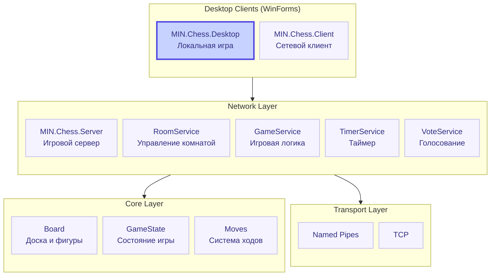
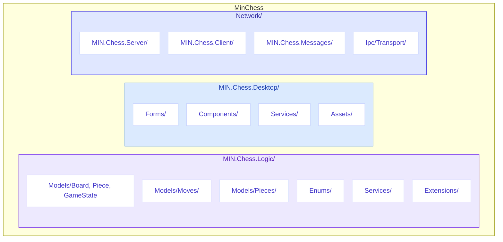

# MinChess


> **Многопользовательские шахматы с полной реализацией правил, таймером и поддержкой наблюдателей**

[](https://github.com/MIN-Corp/MIN.Chess/stargazers)
[](https://github.com/MIN-Corp/MIN.Chess/network/members)
[](https://github.com/MIN-Corp/MIN.Chess/blob/main/LICENSE)
[](https://dotnet.microsoft.com/)
[](https://docs.microsoft.com/en-us/dotnet/csharp/)

[English](README.md) • [Русский](README.ru.md)

---

## Содержание

- [Возможности](#-возможности)
- [Архитектура](#-архитектура)
- [Технологический стек](#-технологический-стек)
- [Установка и запуск](#-установка-и-запуск)
- [Структура проекта](#-структура-проекта)
- [Игровой процесс](#-игровой-процесс)
- [Правила](#-правила)
- [Авторы](#-авторы)

---

## Возможности

| Возможность | Описание |
|-------------|----------|
| **Полная реализация правил** | Все ходы фигур, рокировка, взятие на проходе, превращение пешки |
| **Таймер** | Настраиваемое время партии (1-30 мин) с добавкой (0-20 сек) |
| **Премувы** | Постановка ходов заранее, исполняются при наступлении очереди |
| **Наблюдатели** | Неограниченное количество зрителей одной партии |
| **Смена роли** | Наблюдатель может занять место свободного игрока |
| **Голосование** | Совместное решение о ничьей или рестарте |
| **Сдача** | Возможность признать поражение |
| **Сетевая игра** | Игра через локальную сеть (Named Pipes / TCP) |
| **Desktop UI** | Интуитивный интерфейс на WinForms с drag-and-drop |
| **Отображение взятых фигур** | Визуальный счётчик съеденных фигур оппонента |
| **Меню паузы** | Возможность поставить игру на паузу |

> [!IMPORTANT]
> MinChess работает на платформе **MIN** — через Named Pipes или TCP. Игроки и наблюдатели могут подключаться к одной партии из локальной сети.

---

## Архитектура



### Модули

#### Core (Ядро)
| Модуль | Назначение |
|--------|------------|
| `MIN.Chess.Logic` | Полная реализация шахматной логики |

#### Desktop (UI)
| Модуль | Назначение |
|--------|------------|
| `MIN.Chess.Desktop` | Локальный десктопный клиент |

#### Network (Сеть)
| Модуль | Назначение |
|--------|------------|
| `MIN.Chess.Server` | Сервер партии, обработка сообщений |
| `MIN.Chess.Client` | Сетевой клиент для подключения к партии |
| `MIN.Chess.Messages` | Сообщения и протокол обмена |
| `MIN.Ipc.Transport.NamedPipes` | Транспорт через Named Pipes |
| `MIN.Ipc.Transport.Tcp` | Транспорт через TCP |

---

## Технологический стек

| Категория | Технология | Описание |
|-----------|------------|----------|
| Язык | C# | Современный объектно-ориентированный язык |
| Платформа | .NET 8.0 | Кроссплатформенный фреймворк |
| UI | WinForms | Настольный интерфейс Windows |
| Транспорт | Named Pipes / TCP | Межпроцессное и сетевое взаимодействие |
| Стиль | .editorconfig | Единый код-стайл |

---

## Установка и запуск

### Требования

> [!TIP]
> Убедитесь, что у вас установлен .NET SDK 8.0 или выше.

- [.NET SDK 8.0](https://dotnet.microsoft.com/download/dotnet/8.0) или выше
- Windows 10/11
- Платформа MIN (входит в репозиторий)

### Быстрый старт

```bash
# 1. Клонирование репозитория
git clone https://github.com/MIN-Corp/MIN.Chess.git
cd MinChess

# 2. Восстановление зависимостей
dotnet restore

# 3. Сборка проекта
dotnet build

# 4. Запуск сервера
dotnet run --project Network/MIN.Chess.Server/MIN.Chess.Server.csproj

# 5. Запуск клиента (в отдельном терминале)
dotnet run --project Network/MIN.Chess.Client/MIN.Chess.Client.csproj
```

---

## Структура проекта



> [!NOTE]
> Настройки проекта централизованы через `Directory.Build.props` и `Directory.Packages.props`.

---

## Игровой процесс

1. **Старт партии** — два игрока занимают места белых и чёрных
2. **Настройка таймера** — белый игрок выбирает время партии и добавку
3. **Игра** — игроки ходят по очереди, наблюдатели следят за партией
4. **Премувы** — можно ставить ходы заранее; они исполнятся, когда дойдёт очередь
5. **Окончание** — мат, пат, сдача, тайм-аут, ничья, правило 50 ходов, троекратное повторение

### Управление

| Действие | Описание |
|----------|----------|
| **Drag-and-drop** | Перетаскивание фигуры мышью |
| **Сдаться** | Кнопка «Сдаться» |
| **Ничья** | Кнопка «Предложить ничью» |
| **Пауза** | Escape или кнопка «Пауза» |
| **Рестарт** | Голосование за перезапуск |
| **Обновить состояние** | На случай рассинхронизации |

---

## Правила

> [!IMPORTANT]
> MinChess поддерживает все официальные правила шахмат.

### Реализованные механики

| Правило | Статус |
|---------|--------|
| **Ходы фигур** | Все стандартные ходы короля, ферзя, ладьи, слона, коня и пешки |
| **Рокировка** | Короткая и длинная, с проверкой препятствий и прохода через битое поле |
| **Взятие на проходе** | En passant с валидацией легальности |
| **Превращение пешки** | Выбор фигуры при достижении последней горизонтали |
| **Шах и мат** | Обнаружение шаха, проверка легальности ходов |
| **Пат** | Автоматическое обнаружение |
| **Правило 50 ходов** | Ничья при отсутствии взятий и ходов пешками за 50 ходов |
| **Троекратное повторение** | Ничья при повторении позиции трижды |
| **Недостаток материала** | Ничья при невозможности поставить мат |

---

## Авторы

| Автор | Роль | Вклад |
|-------|------|-------|
| [**CasCadeVR**](https://github.com/CasCadeVR) | Основатель | Основной разработчик, создатель архитектуры |

---

> [!TIP]
> **Сделано с любовью командой CasCade**

*MinChess — шахматы для вашей сети*

---

[](https://github.com/MIN-Corp/MIN.Chess)
[](https://github.com/MIN-Corp/MIN.Chess)

[Исходный код](https://github.com/MIN-Corp/MIN.Chess) • 
[Сообщить об ошибке](https://github.com/MIN-Corp/MIN.Chess/issues) • 
[Лицензия MIT](LICENSE.txt)
